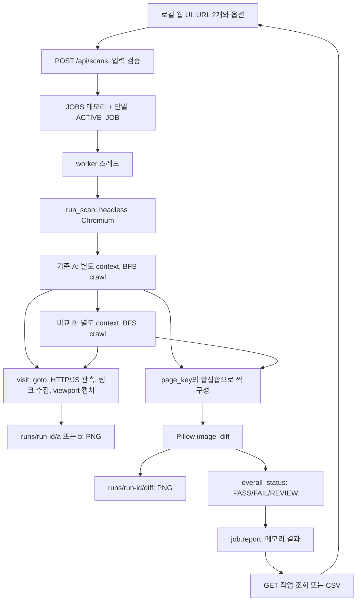

# AS-IS 아키텍처 — 확인된 이전 구현과 현재 저장소의 경계

> **구현 전 OLD 감사 기록입니다.** 후속 제작으로 추가된 현재 코드는 [IMPLEMENTATION_STATUS.md](IMPLEMENTATION_STATUS.md)와 [README](../README.md)를 참고하세요. 아래 빈 저장소·미구현 설명은 감사 시작 시점의 사실입니다.

작성일: 2026-10-30 (Asia/Seoul). 이번 작업은 읽기 전용 코드 감사와 설계 문서 작성이다. 소스, README, 원본 기획서는 수정하지 않았으며 운영/STG 접속·로그인·크롤링은 실행하지 않았다.

## 1. 조사 대상과 증거 기준

| 별칭 | 실제 위치 | 이번 분석에서의 의미 |
|---|---|---|
| `REPO` | `C:\Users\ASUS\Documents\GitHub\Visang-qa-comparator` | 결과 문서를 저장하는 현재 Git 작업 폴더. 조사 시작 시 `.git`만 존재하고 추적 소스·커밋이 없었음 |
| `OLD` | `C:\Users\ASUS\Downloads\web-qa-comparator\web-qa-comparator` | 실제 읽고 검사한 이전 Comparator 구현. 아래 코드 구현 현황의 기준 |
| `PLAN` | `C:\Users\ASUS\Downloads\web-qa-planning-docs\web-qa-planning` | 사용자 지정 기획 원본: `QA_AUTOMATION_PROJECT_SPEC.md`, `CODEX_REPOSITORY_AUDIT_PROMPT.md` |
| `EPC` | `C:\Users\ASUS\Desktop\viva-e-pc` | 대상 사이트 PC 샘플. Comparator 구현과 구별하는 읽기 전용 참고 자료 |
| `MVMH` | `C:\Users\ASUS\Desktop\viva-mv-mh` | 대상 사이트 모바일 샘플. Comparator 구현과 구별하는 읽기 전용 참고 자료 |

`OLD/app.py:56–59` 표기는 위 절대경로의 원본 파일과 1부터 시작하는 라인 번호다. 현재 저장소 안에 해당 소스가 이미 존재한다는 의미가 아니다. 샘플의 상세 기능·정책 근거는 [TEST_STRATEGY.md](TEST_STRATEGY.md), 목표 대비 구현 상태는 [REQUIREMENTS_AND_GAPS.md](REQUIREMENTS_AND_GAPS.md)에 정리한다.

최초 `git status --short`, `git ls-files`는 출력이 없었고, `git log -1`은 현재 `main`에 커밋이 없다고 반환했다. 원격 URL은 `https://github.com/LAPILA/Visang-qa-comparator.git`이었다. GitHub 연결 조회는 404, `git ls-remote`는 DNS 오류여서 **원격 저장소의 존재 여부·내용·최신성은 확인 불가**다. 이 오류로 원격이 비어 있거나 삭제되었다고 판단하지 않는다. 원격 변경·커밋·푸시는 수행하지 않았다.

기획 원본은 현재 저장소에서 발견되지 않아 위 `PLAN` 위치에서 읽었다. 먼저 발견한 Downloads 루트의 동명 사본과 SHA-256이 동일함을 확인했다. 기획 내용은 목표이며 현재 코드의 구현 증거로 사용하지 않는다.

### 감사 시점 원본 식별값

| 파일 | SHA-256 |
|---|---|
| `OLD/app.py` | `63743354C2F775DFDE1F9E49691B8137B8CC93559AC99464F471A0F863401230` |
| `OLD/public/app.js` | `354BC568AFEBE7A67B81BDB2A908981194144C487044DE1E7684D8EFE87558AD` |
| `OLD/tests/test_core.py` | `6AAC07B7359DA0E3FB2CC704F4284F2948D89C1772BF29479068D9D20721FFE1` |

라인 근거는 이 스냅샷에 해당한다. 향후 소스 편입·수정 후에는 commit SHA와 함께 근거를 갱신해야 한다.

## 2. 디렉터리 구조와 기술 스택

조사된 이전 버전의 구조는 다음과 같다. `runs/`에 기존 실행 이미지 폴더가 있다는 사실만으로 과거 테스트 성공·품질을 인정하지 않는다.

```text
OLD/
├─ app.py                  HTTP 서버, 작업 상태, 크롤러, 오류 수집, 이미지 비교, CSV
├─ requirements.txt        Playwright / Pillow 버전 범위
├─ setup_windows.bat       의존성 및 Chromium 설치
├─ run_windows.bat         서버 실행
├─ README.md               사용법과 제한
├─ .gitignore              runs/, .env 등 제외
├─ public/
│  ├─ index.html            URL·옵션 입력 및 결과 UI
│  ├─ app.js                POST, 폴링, 결과 렌더링·필터
│  └─ styles.css            화면 스타일
├─ tests/
│  └─ test_core.py          unittest 5개
└─ runs/<run-id>/
   ├─ a/*.png              기준 사이트 viewport 이미지
   ├─ b/*.png              비교 사이트 viewport 이미지
   └─ diff/*-diff.png      차이 overlay
```

| 항목 | 실제 구현 | 근거 |
|---|---|---|
| 언어·서버 | Python, 표준 `BaseHTTPRequestHandler`/`ThreadingHTTPServer` | `OLD/app.py:8–24,352,448–456` |
| 브라우저 자동화 | Playwright 동기 API, headless Chromium | `OLD/app.py:24,287–298` |
| 이미지 | Pillow `Image`, `ImageChops`, `ImageOps` | `OLD/app.py:23,234–257` |
| 화면 | 별도 빌드 없는 HTML/CSS/JavaScript 정적 파일 | `OLD/app.py:371–377`; `OLD/public/app.js:158–174` |
| 의존성 | `playwright>=1.50,<2`, `Pillow>=11,<13` | `OLD/requirements.txt:1–2` |
| 단위 테스트 | Python `unittest`, mock 방문·합성 이미지 | `OLD/tests/test_core.py:1–7,10–60` |
| 저장 | 이미지 파일 + 프로세스 메모리 작업 dict | `OLD/app.py:26–38,182–189,251–255,331` |

정확한 라이브러리 버전과 브라우저 revision을 고정하는 lock/manifest는 조사된 이전 버전 파일 집합에서 확인하지 못했다. 아래 검증 환경 버전은 이번 환경에서 관측한 값이며 프로젝트가 선언한 고정 버전이 아니다.

## 3. 기존 실행 방식과 API

### 제공된 실행법

`OLD/README.md:5–15`, `OLD/setup_windows.bat:3–9`, `OLD/run_windows.bat:3–5`의 실행법은 다음과 같다. 이는 기존 사용법 기록이며 이번 감사에서 설치나 외부 서버 스캔을 실행했다는 의미가 아니다.

```powershell
Set-Location -LiteralPath 'C:\Users\ASUS\Downloads\web-qa-comparator\web-qa-comparator'
py -m pip install -r requirements.txt
py -m playwright install chromium
py app.py
```

기본 접속 주소는 `http://127.0.0.1:3000`이다. `PORT`로 포트를 바꿀 수 있고 (`OLD/app.py:448–450`), `CHROMIUM_EXECUTABLE_PATH`로 Chromium 경로를 지정할 수 있다 (`OLD/app.py:288–291`). 현재 `REPO`에는 이 엔트리포인트가 없으므로 위 명령을 현재 저장소에서 그대로 실행할 수 없다.

이번 로컬 환경에서는 `python`이 WindowsApps 별칭으로 실행 실패했고, `py`는 `No installed Python found!`를 반환했다. `C:\Users\ASUS\AppData\Local\Programs\Python\Python314\python.exe` 직접 경로는 사용 가능했다. 설치 성공·브라우저 실행 가능 여부와 별개의 관측이다.

### 프런트/백엔드 계약

| 요청 | 입력·출력·상태 | 근거 |
|---|---|---|
| `GET /`, `/index.html`, `/styles.css`, `/app.js` | 정적 파일 | `OLD/app.py:371–377` |
| `POST /api/scans` | JSON의 `baselineUrl`, `candidateUrl`, `maxPages`, `maxDepth`, `visualThreshold`; 성공 `202 {id}` | `OLD/app.py:415–445` |
| `GET /api/scans/{uuid}` | `id,state,progress,startedAt,finishedAt,report,error` 작업 객체 | `OLD/app.py:387–393,438–440` |
| `GET /api/scans/{uuid}.csv` | 완료 보고서 CSV. 작업/보고서 없으면 404 | `OLD/app.py:387–412` |
| `GET /artifacts/{uuid}/{a\|b\|diff}/{file}.png` | 정규식에 맞는 이미지 파일만 반환 | `OLD/app.py:379–385` |

입력 URL은 HTTP(S), hostname, 길이·형식을 확인하고 URL 안의 사용자명/비밀번호를 금지한다 (`OLD/app.py:45–53`). 페이지 수는 1~30(기본10), 깊이 0~4(기본2), 차이 검토 임계값은 0.1~50(기본2)다 (`OLD/app.py:426–430`). 요청 본문 길이는 1~20,000바이트 제한이다 (`419–423`). 이는 전체 네트워크 요청 수·실행시간·부하 상한을 보장하지 않는다.

UI는 폼 값을 JSON으로 보낸 후 작업 ID를 받아 매초 폴링한다 (`OLD/public/app.js:147–174`). `state=done`이면 report, `state=error`면 오류를 표시한다 (`154–155`). 이 작업의 `error`는 개별 검증 결과의 `ERROR` 판정과 다르다. 개별 결과에는 현재 PASS/FAIL/REVIEW만 있다 (`OLD/app.py:267–278,321–322`).

## 4. 요청부터 결과까지의 실제 흐름



1. `Handler.do_POST`가 검사 입력을 검증하고 잠금 안에서 작업을 생성한다. 실행 중이면 409를 반환한다 (`OLD/app.py:415–445`).
2. `worker`는 `run_scan` 성공/예외를 작업의 `done/error` 상태로 저장하고 finally에서 활성 작업을 해제한다 (`328–342`).
3. `run_scan`은 브라우저 하나를 열고 A 크롤링 종료 후 B를 크롤링한다. A와 B의 수집 시점이 같지는 않다 (`287–298`).
4. `crawl`은 사이트별 새 context, deque 큐, URL 중복 집합, `OrderedDict` 페이지를 사용한다 (`199–206`).
5. `visit`은 새 page에 이벤트 listener를 등록하고 `goto`, 제목·h1·링크·깨진 이미지 수집, 화면 캡처를 수행한 뒤 page를 닫는다 (`119–196`).
6. 두 결과의 key 합집합을 순회하여 같은 key의 A/B만 비교한다. 한쪽이 없으면 `ONLY_BASELINE` 또는 `ONLY_CANDIDATE`다 (`300–318`).
7. 결과와 totals는 반환해 메모리에 보관한다. CSV는 요청 시 이 메모리 report에서 생성한다 (`319–325,331,394–412`).

## 5. 핵심 함수와 현재 책임

| 함수·상수 | 동작 | 근거·한계 |
|---|---|---|
| `validate_url`, `normalize_url` | URL 입력 검사, 쿼리 정렬, fragment 제거 | `OLD/app.py:45–59`; hash SPA route까지 제거하는 결함 |
| `origin` | scheme + 소문자 netloc | `OLD/app.py:62–64`; 허용 서브도메인 정책은 없음 |
| `page_key` | root는 `__ROOT__`, 그 외 path + 일부 tracking/session 키 제외 query | `OLD/app.py:67–74`; `.do`·별칭·의미 기반 매핑 없음 |
| `BLOCKED_LINK`, `can_crawl` | 같은 origin HTTP(S), 위험 키워드·파일 링크 제외 | `OLD/app.py:31–35,77–84`; blacklist는 부작용 차단 보장이 아님 |
| `issue_add` | 중복 issue 제거, 길이·개수 제한 | `OLD/app.py:87–96`; 최대35개, 누락·truncation 상태 기록 없음 |
| `BROWSER_EVAL` | title, 첫 h1, `a[href]`, viewport 내 깨진 이미지 | `OLD/app.py:103–115`; DOM/CSS 비교 엔진 아님 |
| `visit` | 관측 listener, 이동, 수집, viewport 이미지 | `OLD/app.py:119–196`; 동작별 assertion·click 없음 |
| `crawl` | BFS, max_pages/depth, same-origin 링크 탐색 | `OLD/app.py:199–231`; 미발견·정책 제외·예산 초과를 SKIP으로 기록하지 않음 |
| `image_diff` | 밝기차25 초과 픽셀 비율, 빨간 overlay | `OLD/app.py:234–257`; 구역·동적 데이터 mask 없음 |
| `overall_status` | FAIL issue 우선, 한쪽 누락/issue/시각차/h1차 REVIEW, 나머지 PASS | `OLD/app.py:267–278`; 비교 불능 상태를 판정에서 놓침 |
| `run_scan`, `worker` | 양측 순차 탐색, 결과 구성, 작업 상태 관리 | `OLD/app.py:281–342` |
| `csv_safe`, `Handler` | CSV formula injection 완화, HTTP 응답 | `OLD/app.py:345–456` |

## 6. 발견·매칭의 한계

`BROWSER_EVAL`은 HTML anchor만 수집한다 (`OLD/app.py:113`). `crawl`도 발견 URL에 `visit`만 호출하므로 버튼 클릭·메뉴 펼치기·폼 입력·popup·download 시나리오는 없다 (`214–226`). “페이지 내 모든 클릭을 검사함”으로 표현할 수 없다. 기존 README 역시 이를 미지원으로 명시한다 (`OLD/README.md:31–35`).

첫 입력 URL끼리는 각각 `__ROOT__`라서 `/main`과 `/`도 비교된다. 그 이후에는 path/query가 달라지면 같은 목적의 페이지라도 짝이 되지 않는다 (`OLD/app.py:67–74,300–310`). 반대로 첫 페이지는 기능이 달라도 자동 한 쌍이 되므로 매칭 정확성 검증이 없다. `finalUrl`을 기록하지만 키는 방문 전 URL로 만들고 (`159,210–214`), redirect 후 최종 URL을 통한 재매칭은 하지 않는다.

`normalize_url`의 fragment 제거는 입력 검증과 큐 등록에 사용된다 (`53,205,222–226`). hash 기반 라우트는 서로 다른 화면이 같은 URL로 축약될 수 있다. 실제 함수 실행에서 `https://example.test/#/a`와 `#/b`가 모두 `https://example.test/`로 변환됨을 확인했다. 이는 사용자 모바일 사이트를 정상 탐색했다고 볼 수 없는 근거다.

## 7. 화면·DOM·CSS 및 데이터 차이

브라우저는 1365×768, device scale1, 한국어 locale, light scheme, reduced motion으로 생성된다 (`OLD/app.py:30,201–203`). `domcontentloaded` 최대20초, `load` 최대5초, font ready, 350ms 고정 대기 뒤 캡처한다 (`156–174`). `load`/font 대기 실패를 무시하며 완료 상태를 증거에 남기지 않는다 (`166–173`).

캡처는 `full_page=False`, animation disabled, caret hide다 (`186–187`). 화면 아래 내용·scroll 상태는 검사되지 않는다. 제목과 첫 h1은 읽지만 비교 판정에는 양측 h1이 모두 존재할 때의 문자열 불일치만 반영한다 (`176–177,276–277`). DOM tree, computed CSS, bounding box, 겹침/잘림 비교는 해당 수집·비교 흐름에 없다 (`103–115,234–257,267–278`).

이미지 비교는 RGB absolute difference를 grayscale로 바꾼 뒤 25보다 큰 픽셀의 수를 전체 면적으로 나눈다 (`242–245`). 소수2자리 차이율과 overlay를 생성한다 (`245–255`). 서버별 공지·교과자료 값 차이와 실제 레이아웃 결함을 구별하는 데이터 정책·구역 태그·마스킹은 없다. 따라서 “홈 전체 차이”를 “홈 > 공지사항 > 제목 잘림” 같은 컴포넌트 결함으로 자동 분해할 수 없다.

실행 임계값 이상의 시각 차이는 `REVIEW`/`VISUAL_DIFF`다 (`274–275,311–312`). UI에서 입력하는 임계값 (`OLD/public/index.html:37–38`)과 실행 후 결과를 좁히는 필터는 다르다. 결과 필터는 상태와 검색어이며 (`OLD/public/app.js:127–130,183–190`), 차이율 범위 필터 구현은 확인되지 않는다. 사용자 보고의 필터 오동작은 실제 UI에서 재현하지 않았다.

## 8. HTTP·JS·네트워크 오류와 판정

| 관측 | 기존 처리 | 코드 근거 |
|---|---|---|
| HTTP ≥400, 동일 origin document/script/stylesheet | FAIL | `OLD/app.py:124–135` |
| HTTP ≥400, XHR/fetch 및 외부 리소스 등 | REVIEW | `OLD/app.py:129–135` |
| 최초 `goto` 최종 응답 ≥400 | FAIL, 메시지에 동일 출처 표기 | `OLD/app.py:156–162` |
| 외부 origin으로 최종 이동 | REVIEW, 후속 수집 중단 | `OLD/app.py:163–165` |
| requestfailed | document FAIL, 나머지 REVIEW; navigation ERR_ABORTED 제외 | `OLD/app.py:139–147` |
| pageerror | JS_ERROR / FAIL | `OLD/app.py:149` |
| console.error | CONSOLE_ERROR / REVIEW | `OLD/app.py:150–151` |
| viewport 안의 깨진 이미지 | BROKEN_IMAGE / FAIL | `OLD/app.py:105–109,179–180` |
| screenshot 예외 | SCREENSHOT_ERROR / REVIEW | `OLD/app.py:185–191` |
| visit 외곽 try의 예외 | NAVIGATION_ERROR / FAIL | `OLD/app.py:192–193` |

외부 401/403을 모두 FAIL 처리한다는 주장은 이 코드와 맞지 않는다. 다만 예상 인증401, 필수 API400, 선택적 widget403을 endpoint·기능 맥락으로 나누는 정책은 없다. 외부 redirect 최종4xx는 origin 확인 이전에 goto의 FAIL 처리에 들어갈 수 있다 (`160–165`). 이 경로는 코드상 위험이며 실제 사이트에서 발생했음을 재현하지 않았다.

개별 issue는 `category,level,message,url`만 가진다 (`92–96`). 스택·요청 메서드·응답 몸체·동작 단계·관측완료 여부는 이 스키마에 없다. 콜백 예외를 묵살하고 (`136–137,146–147`), 최초35개 뒤의 issue를 버리므로 (`95`) 초기 잡음 때문에 후속 중요 오류가 보고서에서 사라질 수 있다. 이 또한 실제 누락 횟수를 측정한 결과가 아닌 설계 위험이다.

**확인된 판정 결함:** 이미지 크기 불일치나 비교 예외는 `differencePercent=None`인 결과를 반환한다 (`240–241,256–257`). `overall_status`는 이 비교 불능을 별도 검사하지 않아 다른 issue가 없으면 PASS로 내려간다 (`267–278`). 실제 원문 함수에 합성 입력을 전달하여 이 결과를 확인했다. 단, screenshot 캡처 실패는 REVIEW issue를 추가하므로 모든 캡처 실패가 PASS라는 뜻은 아니다 (`190–191`).

## 9. 인증·저장·운영 안전·2인 실행의 현재 경계

- 사이트별 새 context는 A/B 쿠키를 기본 격리한다 (`OLD/app.py:199–203,294–296`). 사이트 안에서는 같은 context를 공유하지만 페이지는 매 방문 생성·종료한다 (`122,195,214`).
- 브라우저는 headless이고 사용자 로그인·아이디 기억·storage state 입출력 설정이 없다 (`288`, `201–203`). 사용자 요청의 “아이디만 기억, 비밀번호 수동 입력”은 향후 설계이며 현재 구현이 아니다.
- 다운로드는 context에서 비허용이고 blacklist에 포함된다 (`203`, `31–35`). 별도 승인 다운로드 테스트·파일 검증은 없다.
- 링크 blacklist는 HTTP method나 실제 부작용을 제한하지 않는다 (`77–84`, `156`). 최초 입력 URL은 `can_crawl` 검사를 거치지 않는다 (`424–425`, `204–214`). 외부 redirect도 이동 이후에 감지한다 (`156–165`). “읽기 전용”은 기존 의도이지 보장된 실행 격리가 아니다.
- `runs/`와 `.env`는 gitignore에 있다 (`OLD/.gitignore:2–3`). 하지만 screenshot, URL, console message의 민감정보 제거·보존기간 관리·안전한 공개 export는 이 저장 경로에 없다 (`OLD/app.py:92–96,182–189,379–412`). 실제 유출을 확인했다는 의미는 아니다.
- CSV는 위험한 시작 문자를 작은따옴표로 보호한다 (`345–349,405`). 정적/이미지 URL 허용 범위와 loopback bind도 재사용할 기초 방어다 (`371–385,450`).
- `ACTIVE_JOB` 하나로 프로세스당 한 작업만 허용한다 (`36–38,434–436`). UUID별 이미지 폴더는 있으나 QA 담당자·검수자·검수 잠금·최종 승인 이력은 없다 (`438–440,316–325`).
- 전체 실행 취소·강제 시간예산·요청 rate limit·오래된 artifact 정리는 기존 API와 작업 흐름에서 확인되지 않는다 (`328–342,371–445`).
- PNG는 남지만 작업 결과 JSON과 QA 판정은 영속화하지 않는다 (`36,331,387–395`; `OLD/README.md:37`). 재시작 후 동일 report와 검사 이력을 재열람할 수 있는 구조가 아니다.

## 10. 이번 검증 결과와 재현 방법

검증 환경에서 관측한 버전은 Python **3.14.10**, Playwright **1.64.1**, Pillow **12.3.0**이다. 실제 브라우저 launch나 버전·revision 측정은 하지 않았다. 외부 운영/STG 서버를 호출하지 않았으며 실행시간·탐지율·오탐율·성능 개선 수치는 측정하지 않았다.

| 검증 | 실제 결과 | 해석 |
|---|---|---|
| 기존 `unittest discover` 5개, 기본 TEMP | 4 통과 / 1 오류 | `test_visual_diff`의 임시 디렉터리 쓰기가 sandbox 권한으로 실패. 이미지 알고리즘 결함으로 단정하지 않음 |
| 같은 테스트, 프로세스 안에서 writable tempdir 지정 | **5/5 통과** | URL·키·allowlist·기본 판정·합성 이미지·mock crawl의 기존 단위 범위만 검증 |
| 원문 `normalize_url`을 AST 추출 후 합성 hash URL 전달 | 서로 다른 `#/a`, `#/b`가 같은 URL로 변환 | hash route 손실 확인 |
| 원문 `page_key`에 `.do`/무확장자 URL 전달 | 서로 다른 key | 현재 매칭 규칙의 분리 확인. 실제 두 페이지가 같은 기능이라는 증명은 아님 |
| 원문 `overall_status`에 비교실패 결과 전달 | `differencePercent=None` 및 `diff=None`에서 PASS | 증거 불충분이 PASS로 귀결되는 분기 확인 |
| `image_diff`의 이미지 open을 합성 메모리 이미지/예외로 대체 | 크기가 다른 이미지와 읽기 예외 모두 percent=None → 통합 PASS | 실제 비교 함수의 오류 반환과 판정 연결까지 확인. 파일 쓰기·브라우저 실행 없음 |
| `csv_safe(0)` 직접 호출 | 빈 문자열 `''` 반환 | 0%가 CSV에서 누락되는 코드 경로 확인 (`OLD/app.py:345–349,405–408`) |

기존 5개 테스트의 범위는 `OLD/tests/test_core.py:11–60`이다. 특히 crawl 검사는 fake browser와 fake visit을 사용한다 (`47–60`). 브라우저 통합, 모바일 hash router, 네트워크 수집, 로그인, 기능 시나리오, 사후 UI 필터, 검수 이력은 이 테스트 통과로 검증되지 않는다.

이번 성공 실행과 같은 방식의 재현 명령:

```powershell
Set-Location -LiteralPath 'C:\Users\ASUS\Downloads\web-qa-comparator\web-qa-comparator'
@'
import tempfile
import unittest
tempfile.tempdir = r'C:\Users\ASUS\.codex\visualizations\2026\10\29\01a189f6-0ee4-7c53-8953-e0b2aa16ca7c'
suite = unittest.defaultTestLoader.discover('tests')
result = unittest.TextTestRunner(verbosity=2).run(suite)
raise SystemExit(0 if result.wasSuccessful() else 1)
'@ | & 'C:\Users\ASUS\AppData\Local\Programs\Python\Python314\python.exe' -B -
```

위 경로들은 이번 PC 환경 전용이다. 다른 PC에서는 Python 실행 파일과 쓰기 가능한 임시 디렉터리를 실제 경로로 바꾼다. `tempfile.tempdir`만 해당 프로세스에서 지정하며 전역 환경변수·기존 소스는 바꾸지 않는다. 첫 실패 명령은 같은 직접 실행 파일로 `-B -m unittest discover -s tests -v`를 사용했다.

첫 함수 분기 확인은 원본 `app.py`를 `ast.parse`하여 `normalize_url`, `page_key`, `overall_status` 정의만 선택·실행했다. 별도로 `app`을 import해 같은 합성 입력을 직접 호출했고, 이미지 읽기를 mock한 비교 실패 경로와 CSV 0도 확인했다. import 시 서버/브라우저가 실행되지 않는 것은 `OLD/app.py:287–291,448–456`에서 확인했다. 새 회귀 테스트를 저장소에 추가하거나 기존 테스트를 수정한 작업은 아니다.

추가 실패 경로의 재현 명령(위와 동일한 OLD 작업 디렉터리·Python 경로):

```powershell
@'
import app
from PIL import Image
from unittest.mock import patch
clean = {'issues': [], 'heading': 'same'}
left, right = {'screenshotFile': 'a'}, {'screenshotFile': 'b'}
with patch.object(app.Image, 'open', side_effect=[Image.new('RGB', (20,20)), Image.new('RGB', (21,20))]):
    diff = app.image_diff(left, right, 'audit', 'size')
    print(diff['differencePercent'], app.overall_status(clean, clean, diff, 2))
with patch.object(app.Image, 'open', side_effect=OSError('synthetic read failure')):
    diff = app.image_diff(left, right, 'audit', 'read')
    print(diff['differencePercent'], app.overall_status(clean, clean, diff, 2))
print(repr(app.csv_safe(0)))
'@ | & 'C:\Users\ASUS\AppData\Local\Programs\Python\Python314\python.exe' -B -
```

실제 출력은 순서대로 `None PASS`, `None PASS`, `''`였다. 합성 함수 검증이며 실사이트 장애를 재현한 결과가 아니다.

## 11. 재사용 경계와 다음 설계 연결

| 기존 자산 | 재사용 가치 | 수정·분리 전제 |
|---|---|---|
| URL validation/origin/hash 유틸 | 입력 검증과 안정적 파일 이름의 기초 | hash 라우트와 page identity를 URL 정규화에서 분리 (`OLD/app.py:45–100`) |
| BFS·page/depth 제한 | 무제한 탐색을 막는 뼈대 | 발견·승인·실행·제외 기록 및 시간/행동예산 추가 (`199–231`) |
| Playwright 관측 listener | 이동 전 HTTP/JS 수집 배선 | 관측 사실과 판정 정책, action 단위 귀속 분리 (`124–153`) |
| viewport·animation 설정 | 동일 조건 캡처의 출발점 | device profile·안정화 근거·구역 검사·데이터 마스크 추가 (`166–191,201–203`) |
| Pillow overlay | 추가 서비스 없이 증거 이미지 생성 | 비교 오류를 ERROR로, 의미 구역별 차이/마스크 분모 명시 (`234–257`) |
| 결과 UI·CSV | 현재 보고 흐름을 유지하며 확장 가능 | 5상태, 비율 필터, 구역·action 위치, 검수 기록 추가 (`OLD/public/app.js:127–190`; `OLD/app.py:396–412`) |
| 기존 unittest | 기존 보장 범위의 회귀 기반 | 확인된 결함·계약·합성 브라우저 fixture 테스트 추가 (`OLD/tests/test_core.py:11–60`) |

기존 Python/Playwright/Pillow를 교체해야 한다는 근거는 이번 감사에서 나오지 않았다. 먼저 기존 동작을 테스트로 보존하고 작은 경계로 추출하는 방향을 권장한다. 핵심 엔진 담당과 정책·시나리오·보고 담당의 공통 계약 및 PR 순서는 [ROADMAP.md](ROADMAP.md), 상세 판정·데이터·안전 행동 설계는 [TEST_STRATEGY.md](TEST_STRATEGY.md), 확정/미결정 선택은 [DECISIONS_AND_OPEN_QUESTIONS.md](DECISIONS_AND_OPEN_QUESTIONS.md)를 따른다. 이들은 향후 설계이며 현재 구현 완료 표시가 아니다.
